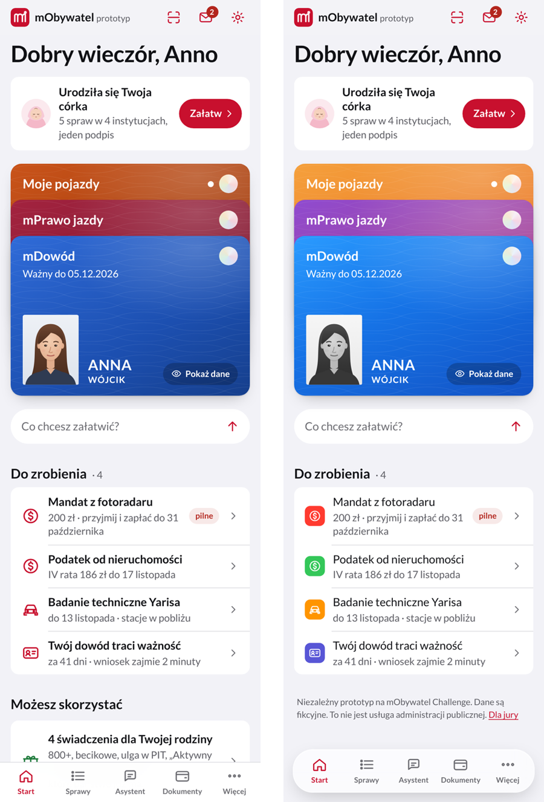
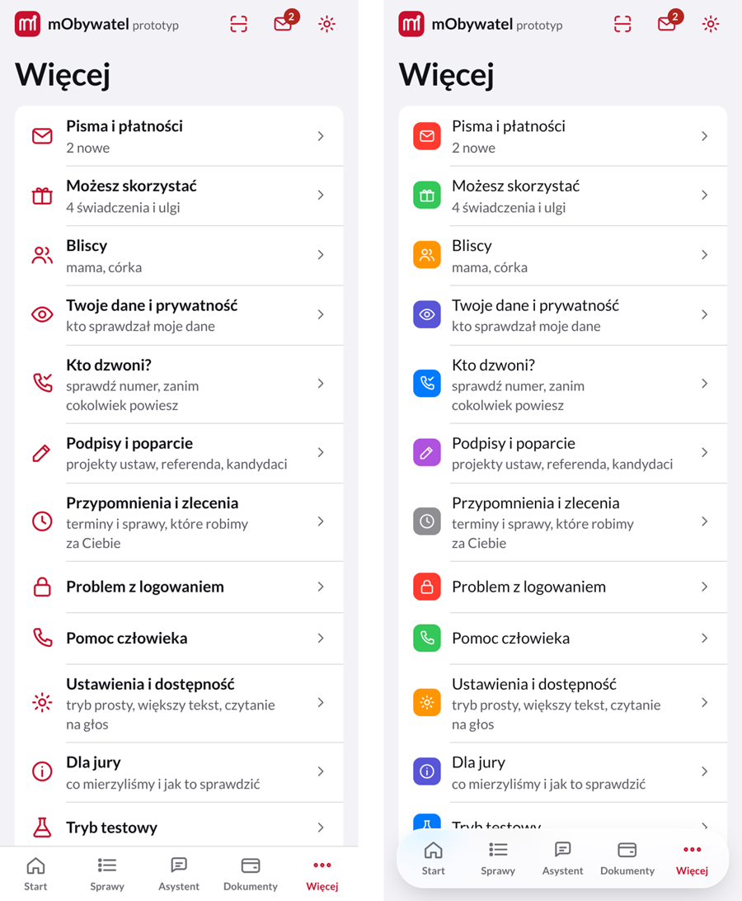

# Propozycje zmian w designie (przegląd 25.10.2026)

> **Stan 26.10.2026:** wdrożone według Apple Human Interface Guidelines: niebieski akcent (czerwień tylko marka i „pilne”), krój systemowy na urządzeniach Apple, kafelki kategorii, „Więcej” w grupach, lżejsze wiersze, pływający pasek kart, pływający arkusz. Nie wdrożono: spokojniejszy Start (P1), nowe kolory kart dokumentów (P1), Kod QR jako zakładka (P2). Opis zmian: [DESIGN.md](../DESIGN.md).

Przegląd całej aplikacji według metody krytyki Impeccable (`critique.md`: ocena heurystyk Nielsena, obciążenie poznawcze, „craft floor”, tryb Operate), porównanie z prototypem referencyjnym i z prawdziwym mObywatelem po zmianie wyglądu z lipca 2025 r. oraz z aktualnym wyglądem iOS. Nic z tego nie jest jeszcze wdrożone; makiety niżej to nakładka CSS na obecną wersję.

## Skąd wnioski

- **Prawdziwy mObywatel (wersja 4.63, lipiec 2025):** ekran główny pokazuje tylko dokumenty (duże karty, małe karty albo lista), usługi przeniesiono do osobnej zakładki z wyszukiwarką i ulubionymi, każda kategoria usług ma **własny kolor**, w dolnym pasku jest **Kod QR**, doszedł tryb ciemny. Karty: jaskrawy niebieski mDowód, **fioletowo-purpurowe** mPrawo jazdy, **pomarańczowo-bursztynowe** pojazdy, delikatny wzór na tle. Linki akcji („Dostosuj”, „Dodaj ulubione”) są **niebieskie**; czerwony to znak marki. Źródła: [Spider's Web](https://spidersweb.pl/2025/07/mobywatel-zmiana-wygladu-nowe-opcje.html), [mobiRANK](https://mobirank.pl/2025/07/31/nowy-mobywatel-jest-zupelnie-odmieniony/), [rp.pl](https://www.rp.pl/w-sadzie-i-w-urzedzie/art42793571-aplikacja-mobywatel-w-nowej-odslonie-oto-co-sie-zmienia).
- **Prototyp referencyjny:** spokojny ekran (portfel, jedna sprawa, pole rozmowy, bez paska kart), karty w kolorach prawdziwej aplikacji, czarno-białe zdjęcie na mDowodzie, auto wystające z karty pojazdów, znaczki w prawym górnym rogu kart.
- **iOS 26 (Liquid Glass):** pasek kart jest pływający i półprzezroczysty, zmniejsza się przy przewijaniu; szkło tylko na warstwie nawigacji, treść nieprzezroczysta ([STRV](https://www.strv.com/blog/how-to-apply-liquid-glass-to-your-app), [Mindbowser](https://www.mindbowser.com/?p=116412)).
- **Diia (Ukraina):** nagrody D&AD i UX Design Awards m.in. za prostotę usług i rozpoznawalny system wizualny na własnym kroju ([D&AD](https://www.dandad.org/awards/professional/2022/236093/diia/), [UX Design Awards](https://ux-design-awards.com/events-media/deep-dive-award-winners-ministry-of-digital-transformation-of-ukraine-diaa-app)).
- **Impeccable, tryb Operate:** „szary ekran z jednym kolorem akcentu to domyślny wygląd kategorii bez jej dopracowania, a nie umiar”; kolor ma robić konkretną robotę (stany, kategorie, wyróżnik). Lista ma 8+ pozycji: przeciążenie pamięci roboczej.

## Ocena obecnej wersji (heurystyki Nielsena, 0–4)

| Heurystyka | Ocena | Dlaczego |
|---|:---:|---|
| 1. Widoczność stanu | 3 | statusy, oś czasu, Face ID; brak stanów ładowania (nie są potrzebne offline) |
| 2. Zgodność ze światem użytkownika | 3 | prosty język, „przypomnienie” i „zlecenie” wyjaśnione |
| 3. Kontrola i swoboda | 3 | „Wróć” w każdym arkuszu, cofanie zastrzeżeń; po podpisie brak edycji |
| 4. Spójność i standardy | 2 | czerwień naraz dla akcji i dla „pilne”; skaner w nagłówku, a w mObywatelu w pasku; pogrubienie wszędzie |
| 5. Zapobieganie błędom | 3 | arkusz zgody przed każdym wysłaniem |
| 6. Rozpoznawanie zamiast pamiętania | 3 | ikony z podpisami; ale ikony jednego koloru trudniej odróżnić |
| 7. Elastyczność | 3 | asystent, skróty, tryb prosty |
| 8. Estetyka i minimalizm | 2 | gęsty ekran Start (7 sekcji), „Więcej” 12 pozycji bez grup, monotonne czerwone ikony |
| 9. Rozpoznawanie i naprawa błędów | 3 | „Nie możesz się zalogować?”, komunikaty walidacji |
| 10. Pomoc | 3 | źródło przy odpowiedziach, pomoc człowieka |
| **Razem** | **28/40** | „dobrze” (70%); najwięcej do zyskania w 4 i 8 |

## Propozycje (od największego efektu)

### P1. Spokojniejszy ekran Start
Start ma dziś 7 sekcji (sprawa, portfel, pole pytania, Do zrobienia, Możesz skorzystać, Bliscy, Przypomnienia). Prawdziwy mObywatel i referencja pokazują portfel i jedną rzecz do zrobienia. Propozycja: **sprawa, która przyszła + portfel + Do zrobienia (najwyżej 3) + pole pytania**; „Możesz skorzystać”, „Bliscy” i „Przypomnienia” jako jeden wiersz „Więcej dla Ciebie” albo w zakładce „Więcej”. Mniej przewijania, wyraźniejszy wyróżnik (sprawa przychodzi sama). *Koszt: mały.*

### P1. Karty w kolorach prawdziwego mObywatela
mPrawo jazdy fioletowo-purpurowe (u nas bordo), pojazdy pomarańczowo-bursztynowe (u nas ceglaste), mDowód jaśniejszy niebieski. Użytkownik rozpoznaje dokument po kolorze, zanim przeczyta nazwę. Zdjęcie na mDowodzie w skali szarości (jak w referencji i na plastikowym dowodzie). Na karcie pojazdów sylwetka auta wystająca zza paska. Znaczek w rogu: kółko z „PL” zamiast godła (godła nie używamy). *Koszt: mały.*

### P1. Kolor w ikonach: kafelki kategorii
Dziś wszystkie ikony są czerwone i liniowe, więc lista wygląda monotonnie, a czerwień miesza się z „pilne”. Propozycja jak w Ustawieniach iOS i kategoriach usług mObywatela: **biała ikona na kolorowym kwadracie**, kolor według kategorii (np. pieniądze zielony, pojazdy pomarańczowy, dane i prywatność fiolet, rodzina różowy, bezpieczeństwo czerwony, pomoc niebieski). Kolor zaczyna nieść informację. *Koszt: średni (słownik kategorii, kontrast w obu motywach).*

### P2. „Więcej” w grupach
12 pozycji w jednej liście przekracza pamięć roboczą (8+ to przeciążenie). Grupy z nagłówkami: **Twoje sprawy** (Pisma i płatności, Możesz skorzystać, Bliscy, Przypomnienia), **Bezpieczeństwo i dane** (Twoje dane, Kto dzwoni?, Problem z logowaniem), **Udział** (Podpisy i poparcie), **Pomoc i ustawienia**, **O prototypie** (Dla jury, Tryb testowy). *Koszt: mały.*

### P2. Lżejsze wiersze list
Tytuły wierszy są pogrubione wszędzie, przez co nic się nie wyróżnia. W iOS tytuł wiersza ma zwykłą grubość, a pogrubione są tytuły ekranów, kwoty i nagłówki. *Koszt: mały.*

### P2. Pływający pasek kart (iOS 26)
Na obecnych iPhone'ach pasek kart jest pływającą, półprzezroczystą „kapsułą”. Nasz wygląda jak w iOS 17. Szkło tylko na pasku, treść pozostaje nieprzezroczysta (zasada Apple i Impeccable). *Koszt: mały; do sprawdzenia kontrast podpisów na kolorowych kartach pod spodem.*

### P2. Kod QR jako zakładka
W prawdziwym mObywatelu „Kod QR” jest w dolnym pasku. U nas ikona w nagłówku. Propozycja: zakładka **Kod QR** zamiast „Dokumenty” (dokumenty są na Starcie, jak w mObywatelu), albo pozostawić nagłówek i dodać zakładkę. *Koszt: mały; zmienia nawigację, więc do decyzji.*

## Do decyzji (zmieniają tożsamość)

- **Kolor akcji: niebieski zamiast czerwonego?** W mObywatelu linki i akcje są niebieskie, czerwony to marka. U nas czerwień jest naraz akcją i ostrzeżeniem („pilne”, błędy). Niebieski akcent uspokoiłby ekran i rozdzielił znaczenia; czerwień zostałaby dla marki i spraw pilnych. To duża zmiana wyglądu, dlatego tylko jako propozycja.
- **Krój: Lato czy systemowy (SF na iPhonie)?** Prawdziwy mObywatel i zasady iOS używają kroju systemowego. Lato wybraliśmy świadomie (polski projekt); systemowy krój wyglądałby bardziej natywnie i nie trzeba by go pobierać.
- **Ilustracje osób czy zdjęcia?** Referencja ma fotografie. Nasze ilustracje są bezpieczne prawnie (osoby fikcyjne). Kompromis: ilustracja w skali szarości na dokumencie (makieta wyżej).

## Czego nie zmieniać

- Arkusz zgody, oś czasu po wysłaniu, Face ID w Dynamic Island, portfel kart jako wyróżnik.
- Listy grupowane i duże tytuły (zgodne z iOS i z mObywatelem).
- Progi jakości: 0 naruszeń axe, 0 zgłoszeń Impeccable, Lighthouse ≥ 95 po każdej zmianie.

## Czego ten przegląd nie sprawdził

- Wyglądu na prawdziwych telefonach i w Safari (tylko Chromium).
- Opinii użytkowników: liczby wyżej to ocena ekspercka, nie test z ludźmi (scenariusz w [SCENARIUSZ_TESTU.md](SCENARIUSZ_TESTU.md)).
- Kolory kafelków na makiecie są przykładowe (po kolei), nie według kategorii.
